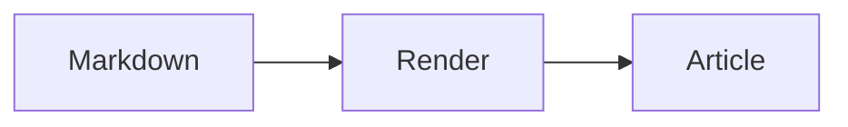

# H1 / 見出しの表示例
## H2 / 見出しの表示例
### H3 / 見出しの表示例
#### H4 / 見出しの表示例
##### H5 / 見出しの表示例
###### H6 / 見出しの表示例

本文は20px、行間は1.8倍です。日本語の長い文章でも行を追いやすいように、読み幅を800pxに抑えます。

段落はまとまりごとに余白を取ります。  
明示的な改行は同じ段落内で表示します。

通常の本文と **強調したテキスト** を並べます。*emphasis* / ***strong emphasis*** / ~~取り消し線~~ / 設定値 `pageSize = 12` は本文の中で区別します。

[記事一覧へ戻る](/blog/) / <https://tsusu0409.com/> / [参照リンク][ref] / \*エスケープ\*

[ref]: https://tsusu0409.com/blog/

- Astroでページを作成する
  - 記事一覧を表示する
  - Markdownの本文を表示する
    - インラインコードと画像を扱う
- 公開前に表示を確認する

1. 記事をMarkdownで書く

   本文や画像、コードブロックを追加します。
2. プレビューを確認する
3. 公開する

- [x] 本文の表示を確認する
- [ ] モバイル表示を確認する

> 引用文は左の罫線と余白で、本文から区別します。
>
> > 引用の中の引用も、さらにインデントします。

---

| 項目：左揃え | 状態：中央揃え | 件数：右揃え |
| :--- | :---: | ---: |
| Markdown | 対応 | 12 |
| Code block | 対応 | 3 |
| 長いセルは折り返して表示します長いセルは折り返して表示します長いセルは折り返して表示します | 表示例 | 120 |

```astro title="src/pages/posts.astro" {5-6}
---
import { getCollection } from "astro:content";

const posts = await getCollection("blog");
const pageSize = 12;
const visiblePosts = posts.slice(0, pageSize);
---

<PostGrid posts={visiblePosts} />
```

```sh title="Terminal"
$ npm install
$ npm run dev

astro  ready in 420 ms
```

```diff title="src/config.ts"
- const pageSize = 24;
+ const pageSize = 12;
  const sort = "latest";
```

```typescript title="src/config.ts"
const endpoint = "https://api.example.com/posts?sort=latest&limit=12&include=title,description,thumbnail,source,publishedAt,tags,author";
```

```unknownlang
未知の言語はプレーンテキストで表示する <b>HTMLとして解釈しない</b>
```

```
project/
  src/
    pages/
      index.astro

  package.json
```

    indented code


本文の流れを保ちながら、補足情報を脚注にまとめます。[^1]

[^1]: 参照資料や補足説明を記載します。

文中の数式 $E = mc^2$ も本文と同じ行に表示します。

$$
\sum_{i=1}^{n} x_i = \frac{n(n+1)}{2}
$$

> [!NOTE]
> 補足情報をここに記載します。

> [!TIP]
> 操作や実装に役立つヒントを記載します。

> [!IMPORTANT]
> 本文の中で押さえておきたい点を記載します。

> [!WARNING]
> 事前に確認が必要な点を記載します。

> [!CAUTION]
> 注意が必要な操作について記載します。

<details>
<summary>補足情報</summary>

必要に応じて展開する説明や、長い実装例をまとめる領域です。

</details>

検索を開く <kbd>Ctrl</kbd> + <kbd>K</kbd> / <mark>ハイライトした本文</mark> / x<sup>2</sup> / H<sub>2</sub>O


